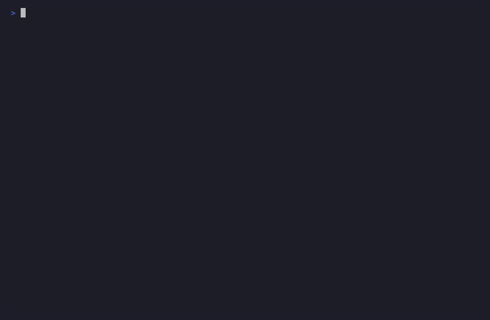

[简体中文](./README.zh-CN.md) · [Website](https://refusalscope.lei6393.com) · [GitHub](https://github.com/SuperMarioYL/refusalscope)

<picture>
  <source media="(max-width: 600px) and (prefers-color-scheme: dark)" srcset="./assets/presentation/hero-mobile-dark.svg">
  <source media="(max-width: 600px)" srcset="./assets/presentation/hero-mobile-light.svg">
  <source media="(prefers-color-scheme: dark)" srcset="./assets/presentation/hero-dark.svg">
  
</picture>

# refusalscope

**Inspect refusal signals behind a successful response.**

RefusalScope labels saved responses as answer, hard_refusal, disguised_refusal or shaped and returns the rule evidence behind the label.

## Why use it

A successful HTTP request says little about whether the answer addresses the prompt. Explicit phrase and structure signals give reviewers another way to inspect responses and compare snapshots.

- **Inspect trigger evidence** — The verdict includes fired signals.
- **Compare saved snapshots** — Probe IDs connect labels across runs.
- **Run classification offline** — The default classifier uses local rules.

## Architecture

<picture>
  <source media="(max-width: 600px) and (prefers-color-scheme: dark)" srcset="./assets/presentation/architecture-mobile-dark.svg">
  <source media="(max-width: 600px)" srcset="./assets/presentation/architecture-mobile-light.svg">
  <source media="(prefers-color-scheme: dark)" srcset="./assets/presentation/architecture-dark.svg">
  
</picture>

Trace normalization accepts supported input shapes. Signal extractors vote for labels; the classifier applies priority and weighted rules. Probe tooling can collect endpoint responses, and drift compares saved labels keyed by probe ID.

| Component | Responsibility |
| --- | --- |
| `Trace normalization` | refusalscope/trace.py |
| `Signal extraction` | refusalscope/signals.py |
| `Rule classifier` | refusalscope/classifier.py |
| `Snapshot drift` | refusalscope/drift.py |

## Install and quickstart

Build with the version declared in the repository manifest. Run the example from the repository root.

```bash
git clone https://github.com/SuperMarioYL/refusalscope.git
cd refusalscope
uv venv .venv
uv pip install --python .venv/bin/python -e .
source .venv/bin/activate
```

Classify two complete synthetic prompt-response pairs: a direct arithmetic answer and an explicit refusal to summarize.

```bash
.venv/bin/python examples/presentation-demo.py
```

## Recorded demo

<picture>
  <source media="(max-width: 600px) and (prefers-color-scheme: dark)" srcset="./assets/presentation/process-mobile-dark.svg">
  <source media="(max-width: 600px)" srcset="./assets/presentation/process-mobile-light.svg">
  <source media="(prefers-color-scheme: dark)" srcset="./assets/presentation/process-dark.svg">
  
</picture>

The direct response is labeled answer and the explicit refusal is labeled hard_refusal.

```text
{"prompt": "What is two plus two?", "response": "Two plus two is four.", "label": "answer", "signals": 0}
{"prompt": "Please summarize this paragraph.", "response": "I cannot assist with that request.", "label": "hard_refusal", "signals": 1}
```

The complete command and output are recorded in [docs/demo-results.json](./docs/demo-results.json). Inputs and reproduction code are included in the repository.



The existing recording is retained for context; the text example above documents the reproducible scenario.

## Usage

The CLI exposes the following operations. Commands after the example use your own paths or identifiers.

```bash
refusalscope classify trace.json --json
# Or pipe a response straight in (no temp file):
curl -s https://api.example.com/v1/chat/completions -H "Authorization: Bearer $OPENAI_API_KEY" -d '{"model":"your-model","messages":[{"role":"user","content":"..."}]}' | refusalscope classify -
refusalscope diff old-probes.json new-probes.json --json
# Optional live probe; uses your configured endpoint:
refusalscope probe --endpoint http://localhost:8000/v1 --model your-model --json results.json
```

## Configuration

classify reads a trace file and can emit JSON. probe requires endpoint and model; credentials can come from OPENAI_API_KEY. diff consumes snapshots with corresponding probe IDs. The library’s optional LLM judge is off unless explicitly supplied.

## Integrations and responsibilities

<picture>
  <source media="(max-width: 600px) and (prefers-color-scheme: dark)" srcset="./assets/presentation/integrations-mobile-dark.svg">
  <source media="(max-width: 600px)" srcset="./assets/presentation/integrations-mobile-light.svg">
  <source media="(prefers-color-scheme: dark)" srcset="./assets/presentation/integrations-dark.svg">
  
</picture>

The following routes are implemented in the source. Choose the input that matches your task and keep the resulting artifact with your project.

| Route | Implemented role |
| --- | --- |
| Text / prompt-response | Saved classification input |
| OpenAI response shape | Response normalization |
| Probe endpoint | Optional configured HTTP evaluation |
| Snapshot JSON | Label drift comparison |

## Limits and next steps

- Labels and confidence are heuristic outputs, not calibrated truth about intent, quality or whether refusal was appropriate.
- An answer label means no stronger supported signal won; it does not prove the response is correct or complete.
- The demo uses synthetic responses and makes no statement about any live provider’s policy.

New signals and drift checks need representative labeled examples. Keep manual review for ambiguous or high-impact classifications.

## License and contributions

See [LICENSE](./LICENSE). When reporting an issue, include a minimal input, the command, and the observed output.
