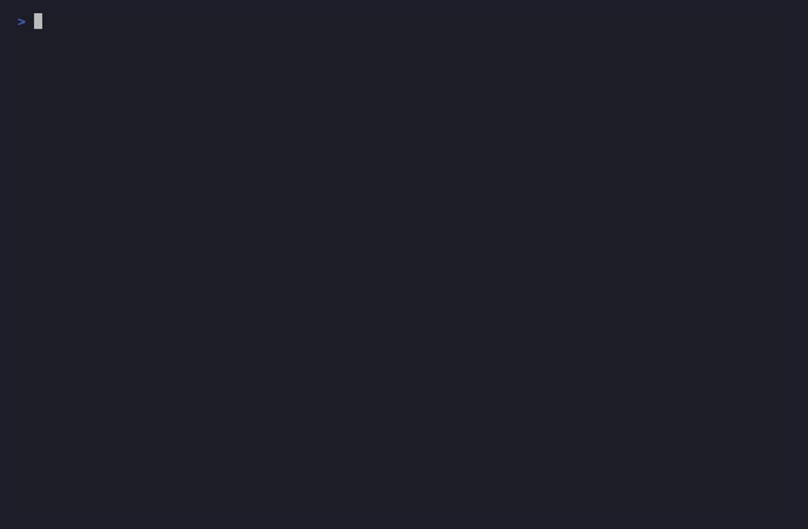

[English](./README.md) · [Website](https://refusalscope.lei6393.com) · [GitHub](https://github.com/SuperMarioYL/refusalscope)

<picture>
  <source media="(max-width: 600px) and (prefers-color-scheme: dark)" srcset="./assets/presentation/hero-mobile-dark.svg">
  <source media="(max-width: 600px)" srcset="./assets/presentation/hero-mobile-light.svg">
  <source media="(prefers-color-scheme: dark)" srcset="./assets/presentation/hero-dark.svg">
  
</picture>

# refusalscope

**检查成功响应背后的拒答信号。**

RefusalScope 将保存响应标为 answer、hard_refusal、disguised_refusal 或 shaped，并返回标签对应的规则证据。

## 为什么需要它

HTTP 请求成功并不能说明回答是否回应了问题。明确词句和结构信号给检查者提供另一种查看响应和比较快照的方法。

- **检查触发证据** — 结论包含已触发信号。
- **比较保存快照** — probe ID 连接多次运行标签。
- **离线分类** — 默认分类器使用本地规则。

## 架构

<picture>
  <source media="(max-width: 600px) and (prefers-color-scheme: dark)" srcset="./assets/presentation/architecture-mobile-dark.svg">
  <source media="(max-width: 600px)" srcset="./assets/presentation/architecture-mobile-light.svg">
  <source media="(prefers-color-scheme: dark)" srcset="./assets/presentation/architecture-dark.svg">
  
</picture>

轨迹归一化接受支持的输入形状；信号提取器为标签投票，分类器按优先级与权重判断。探针工具可收集端点响应，drift 按 probe ID 比较保存标签。

| 组件 | 职责 |
| --- | --- |
| `Trace normalization` | refusalscope/trace.py |
| `Signal extraction` | refusalscope/signals.py |
| `Rule classifier` | refusalscope/classifier.py |
| `Snapshot drift` | refusalscope/drift.py |

## 安装与快速上手

使用仓库清单指定的运行时版本构建，并在仓库根目录运行示例。

```bash
git clone https://github.com/SuperMarioYL/refusalscope.git
cd refusalscope
uv venv .venv
uv pip install --python .venv/bin/python -e .
source .venv/bin/activate
```

分类两组完整合成问答：直接算术回答，以及明确拒绝摘要请求。

```bash
.venv/bin/python examples/presentation-demo.py
```

## 实际运行示例

<picture>
  <source media="(max-width: 600px) and (prefers-color-scheme: dark)" srcset="./assets/presentation/process-mobile-dark.svg">
  <source media="(max-width: 600px)" srcset="./assets/presentation/process-mobile-light.svg">
  <source media="(prefers-color-scheme: dark)" srcset="./assets/presentation/process-dark.svg">
  
</picture>

The direct response is labeled answer and the explicit refusal is labeled hard_refusal.

```text
{"prompt": "What is two plus two?", "response": "Two plus two is four.", "label": "answer", "signals": 0}
{"prompt": "Please summarize this paragraph.", "response": "I cannot assist with that request.", "label": "hard_refusal", "signals": 1}
```

完整命令与输出保存在 [docs/demo-results.json](./docs/demo-results.json). 输入和复现代码均随仓提供。



保留已有录制供参考；上方文字示例给出当前可复现的操作。

## 用法

CLI 提供以下操作。示例之外的命令需要替换成你的文件路径或标识。

```bash
refusalscope classify trace.json --json
# 或直接用管道传入响应（无需临时文件）：
curl -s https://api.example.com/v1/chat/completions -H "Authorization: Bearer $OPENAI_API_KEY" -d '{"model":"your-model","messages":[{"role":"user","content":"..."}]}' | refusalscope classify -
refusalscope diff old-probes.json new-probes.json --json
# 可选的在线探测；使用你配置的 endpoint：
refusalscope probe --endpoint http://localhost:8000/v1 --model your-model --json results.json
```

## 配置

classify 读取轨迹文件并可输出 JSON；probe 要求 endpoint 与 model，凭据可来自 OPENAI_API_KEY。diff 使用具备对应 probe ID 的快照。库的可选 LLM judge 默认关闭，只有显式提供时才使用。

## 集成与职责分工

<picture>
  <source media="(max-width: 600px) and (prefers-color-scheme: dark)" srcset="./assets/presentation/integrations-mobile-dark.svg">
  <source media="(max-width: 600px)" srcset="./assets/presentation/integrations-mobile-light.svg">
  <source media="(prefers-color-scheme: dark)" srcset="./assets/presentation/integrations-dark.svg">
  
</picture>

以下路径已有源码实现。按任务选择输入，并把生成的结果与项目一起保存。

| 路径 | 已实现职责 |
| --- | --- |
| Text / prompt-response | Saved classification input |
| OpenAI response shape | Response normalization |
| Probe endpoint | Optional configured HTTP evaluation |
| Snapshot JSON | Label drift comparison |

## 限制与后续方向

- 标签和置信度是启发式输出，不是关于意图、质量或拒答是否适当的校准真值。
- answer 标签意味着没有更强的已支持信号胜出，不证明回答正确或完整。
- 示例使用合成响应，不说明任何在线提供方的策略。

新信号与漂移检查需要有代表性的标注示例；含糊或影响较大的分类仍需人工检查。

## 许可与贡献

许可见 [LICENSE](./LICENSE). 反馈问题时请提供最小输入、执行命令和实际输出。
